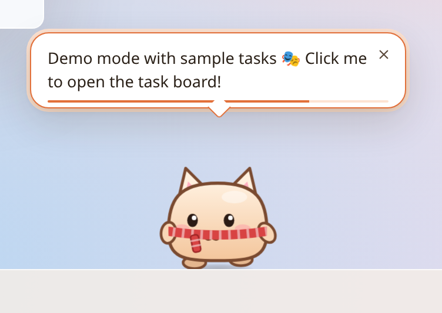
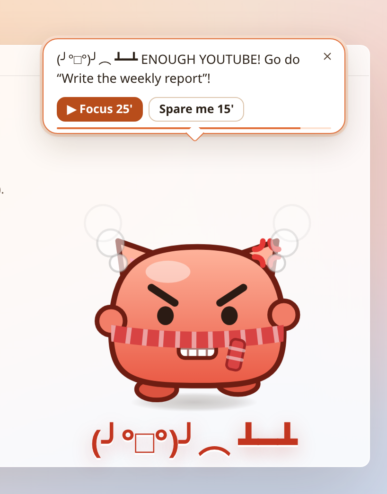
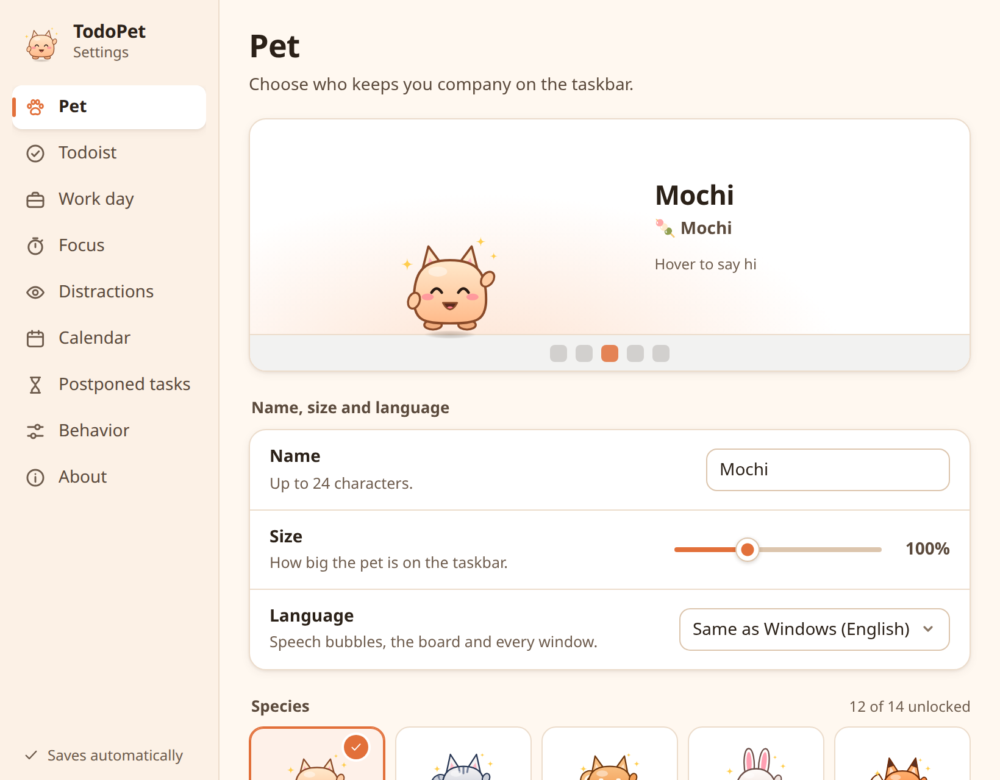

<p align="center"></p>

<h1 align="center">TodoPet for Windows</h1>

<p align="center">
A desktop pet for Windows 10/11 that lives on top of your taskbar, reads your <a href="https://todoist.com">Todoist</a> tasks,
and gets <b>happy when you work</b> and <b>grumpy when you don't</b>. Now with <b>14 species</b>.<br>
English · <a href="README.vi.md">Tiếng Việt</a> · Windows port of <a href="https://github.com/trananhtung/todopet">TodoPet for macOS</a>
</p>


## What's new on Windows

- **14 pets instead of one.** Mochi (the original round cat-eared mochi), Cat, Shiba, Bunny, Fox, Panda, Penguin, Frog, Hamster, Axolotl, Capybara and Duckling from the start, plus a **Baby Dragon** (unlocked by a 7-day streak) and a **Unicorn** (unlocked after 50 finished tasks). Each one has its own body, gait (bounce, hop, waddle, float or scurry) and voice, and all of them share the moods, growth stages, hunger, dirt, accessories and celebrations. Pick yours in **Settings → Pet**.
- **Native Windows integration.** Lives above the taskbar on your primary monitor, clicks pass through everywhere except the pet, its bubbles and the board. Tray icon with mood and progress (`😊 2/3`, `🍅 18:42`), **Ctrl+Alt+T** to add a task from anywhere, start with Windows, and it hides while a full-screen game, video or slideshow is in front.
- **Any calendar.** Paste an ICS link (Google Calendar's "Secret address in iCal format", Outlook's "Publish calendar", iCloud) instead of relying on a system calendar. Recurring meetings and their exceptions are handled.

## What it does

Everything from the macOS app:

- **Walks around your screen.** It wanders along the taskbar, looks at your cursor, and stops and blushes when you hover it. Drag it anywhere and it falls back down.
- **Asks "what are we doing today?"** If today has fewer than **3 tasks** (configurable), it asks you to plan, gently in the morning and more insistently once the planning deadline passes.
- **Reminds you of the right task** with "eat the frog" ordering, nudges every 45 minutes, and pings you 10 minutes before timed tasks.
- **Has real moods.** It celebrates every finished task (including ones you tick off in Todoist), and gets annoyed, then grumpy, when tasks are overdue, nothing moves for hours, or you sit on a distracting site. When grumpy it marches toward your cursor 😤
- **Lets you work with Todoist from the pet.** Click it for today's tasks: complete, add (Today / Tomorrow / No date / full quick-add syntax like `Call Anna 3pm p1 #Work`), move, delete (after a confirmation), focus, split.
- **Focus timer**, **end-of-day review**, **time-block suggestions** in your free gaps, and **splitting tasks you keep postponing** into 15–30 minute steps (optionally with Claude).
- **Catches distracting websites and apps.** It reads the active tab's address in Chrome, Edge, Brave, Vivaldi, Opera and Firefox through Windows UI Automation (falling back to the window title), and the name of the app in front.
- **A pet that lives with your work:** fullness, dirt and flies after lazy days, XP and five growth stages, random celebrations with a rare golden treat, combos and fireworks, accessories to unlock, a sticker book, and escalating mischief (a sign parade, and a table flip in the middle of your screen) that never fires while you're typing, in a meeting or focusing.
- **Designed not to break your focus:** it interrupts only at a pause, holds non-urgent bubbles while you're in the zone, spaces bubbles at least 15 minutes apart, keeps still while you type, and is quiet by default.
- **A diary** of every reminder and why it fired, to tune it to how you work.
- **English and Vietnamese.**


| Bubble | Mischief | Settings |
|---|---|---|
|  |  |  |

## Install

Download the latest installer from **[Releases](https://github.com/trananhtung/todopet-windows/releases)**: `TodoPet_x.y.z_x64-setup.exe` (per-user, no admin) or the `.msi`. Windows 10 (1803+) and 11 are supported; the WebView2 runtime that ships with Windows is used.

> The installer isn't code-signed yet, so SmartScreen may say "Windows protected your PC". Choose **More info → Run anyway**.

Want to look around first? Run `TodoPet.exe --demo` to use sample tasks, no account needed.

## Connect Todoist

1. In Todoist open **Settings → Integrations → Developer** ([direct link](https://app.todoist.com/app/settings/integrations/developer)) and copy your **API token**.
2. Click the pet, paste the token and press **Save & connect**.

The token is stored in **Windows Credential Manager** (as `TodoPet`) and is only ever sent to `api.todoist.com` (Todoist API v1). It never reaches the UI layer: the Rust side reads it and makes the calls.

### Calendar (optional)

**Settings → Calendar**, paste one ICS link per line:

- **Google Calendar:** Settings → your calendar → *Integrate calendar* → **Secret address in iCal format**.
- **Outlook / Microsoft 365:** Settings → Calendar → Shared calendars → **Publish a calendar** → ICS link.
- **iCloud:** share the calendar as a public calendar and use the `webcal://` link.

### Splitting tasks with Claude (optional)

Add an Anthropic API key in **Settings → Postponed tasks** ([get one](https://console.anthropic.com/settings/keys)). When you press **Ask Claude** in the split view, the task's title and notes are sent to the Claude API, which returns 3–5 small steps. It uses `claude-opus-5-5` at low effort with structured JSON output, with server-side fallback enabled in case a request is declined. You can change the model in Settings.

## Using it

| Action | What happens |
|---|---|
| Click the pet | Opens the task board |
| Hover a task on the board | ▶ focus · ✂️ split · → move · 🗑 delete (asks first) |
| Drag the pet | Moves it; let go and it drops back to the taskbar |
| Right-click the pet / tray icon | Board / tray menu: add task, focus, hide 1 h, quiet 1 h, settings, diary, quit |
| <kbd>Ctrl</kbd><kbd>Alt</kbd><kbd>T</kbd> | Opens the board with the add field focused, from any app |
| <kbd>Esc</kbd> | Closes the board |

## How the mood works

The pet keeps a 0–100 happiness score, recalculated every 15 seconds (same formula as the macOS app). Hover the mood line on the board to see the breakdown.

| Makes it happier | Makes it grumpier |
|---|---|
| +8 per task completed today | −7 per overdue task |
| +30 when today's plan is fully done | −4 per task that's past its time |
| Up to +15 right after you finish something | −12 to −50 when fewer than 3 tasks are planned after the planning deadline |
| +10 during a focus session | Up to −30 when nothing moves for more than 90 minutes |
| Meeting time counts as work | Up to −35 after 2+ minutes in a distracting app or website |
| | −3 per task that keeps getting postponed (up to −9) |
| | Up to −15 when it's hungry · −5 per level of dirt |

Score ≥ 75 is happy, ≥ 50 chill, ≥ 30 annoyed, and anything lower grumpy. Outside work hours, at night, in meetings, or after 10 minutes away it calms down or falls asleep.

## Privacy

- No analytics and no servers of its own. Network traffic goes to `api.todoist.com`, your ICS links, and to `api.anthropic.com` only when you press **Ask Claude**.
- Distraction detection reads the **name of the app in front** and, for browsers, the **address of the active tab**. Addresses stay in memory and are never stored or sent anywhere.
- Typing detection uses a keyboard hook that records **only the time of the last key press** — never which key.
- Settings, the pet's life and the diary are local files in `%APPDATA%\com.trananhtung.todopet`. The diary keeps 14 days and can be turned off.
- Spoken lines use the voices built into Windows, offline.

## Development

Built with **Tauri 2** (Rust) and **React + TypeScript**. All logic is plain TypeScript in `src/core` and runs in a browser with a demo backend, so you can work on everything except the Windows integration on any OS.

```bash
npm install
npm run dev            # http://localhost:1420 — open /overlay.html?demo, /settings.html?demo, /gallery.html
npm test               # Vitest: mood, life, calendar, brain rules, pet renderer, motion
npm run typecheck
cd src-tauri && cargo test -p todopet-core   # Rust: validation, Todoist/Claude parsing
npm run tauri dev      # on Windows: the real app
npm run tauri build    # on Windows: NSIS .exe and .msi in src-tauri/target/release/bundle
```

`overlay.html?demo&antic=parade` (or `block`, `grumble`) plays a stunt right away. Releases are built by GitHub Actions on `windows-latest` when a `v*` tag is pushed.

| Path | Role |
|---|---|
| `src/core/brain.ts` | Sync, mood, reminder rules, focus timer, actions (port of `Brain.swift`) |
| `src/core/mood.ts` · `life.ts` · `calm.ts` · `stuck.ts` | Pure rules: mood score, pet life, interruption rules, postponed tasks |
| `src/core/calendar.ts` | ICS parsing (`ical.js`), free time, time-block suggestions |
| `src/core/lines.ts` · `l10n.ts` | Everything the pet says, in English and Vietnamese |
| `src/pets/` | The 14 species, drawn in SVG for every mood, stage and accessory |
| `src/overlay/` | The pet surface: motion, bubble, board, mischief, effects |
| `src/settings/` · `src/diary/` | The Settings and Diary windows |
| `src/backend/` | The `Backend` interface, its Tauri implementation and the in-memory demo |
| `src-tauri/` | Rust: overlay window, click-through, tray, hotkey, Win32 watchers, Credential Manager, HTTP |

## License

[MIT](LICENSE)
