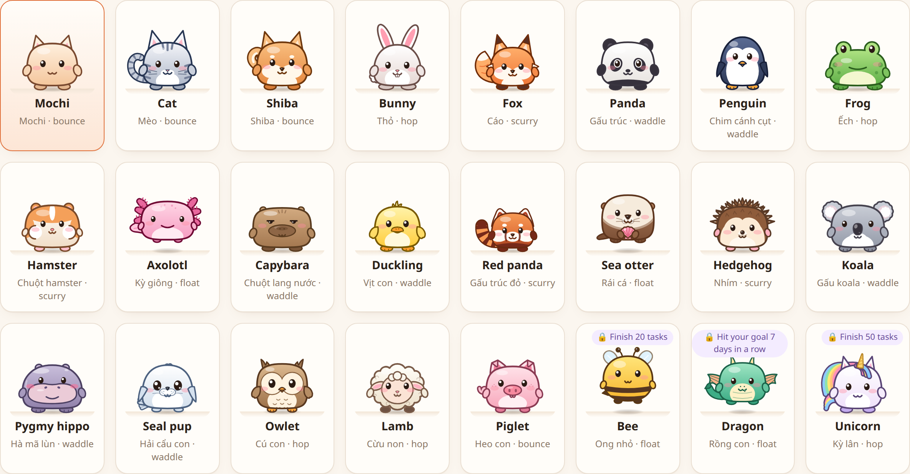
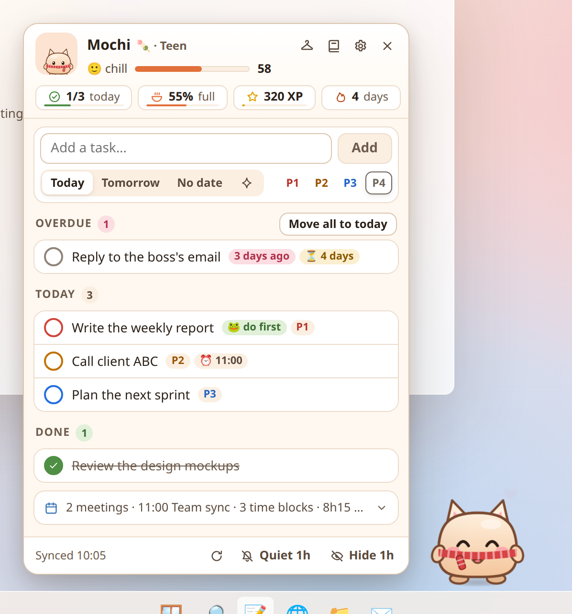

<h1 align="center">TodoPet cho Windows</h1>

Thú cưng trên màn hình Windows 10/11, sống trên thanh tác vụ, đọc việc trong <a href="https://todoist.com">Todoist</a>,
<b>cổ vũ khi bạn làm việc</b> và <b>lo lắng (rồi giúp bạn) khi mọi thứ chậm lại</b>. Giờ có tới <b>24 loài</b>. 
<a href="README.md">English</a> · Tiếng Việt · Bản Windows của <a href="https://github.com/trananhtung/todopet">TodoPet cho macOS</a>

## Có gì mới trên Windows

- **24 bạn thay vì 1.** Mochi (bánh mochi tai mèo gốc), Mèo, Shiba, Thỏ, Cáo, Gấu trúc, Chim cánh cụt, Ếch, Chuột hamster, Kỳ giông, Chuột lang nước, Vịt con, Gấu trúc đỏ, Rái cá, Nhím, Gấu koala, Hà mã lùn, Hải cẩu con, Cú con, Cừu non và Heo con có sẵn từ đầu, cộng thêm **Ong nhỏ** (mở khoá sau 20 việc), **Rồng con** (mở khoá khi giữ chuỗi 7 ngày) và **Kỳ lân** (mở khoá sau 50 việc). Mỗi loài có dáng, kiểu đi (nảy, nhảy, lạch bạch, bay lơ lửng, lon ton) và tiếng kêu riêng; tất cả đều có tâm trạng, lớn lên, đói, bẩn, phụ kiện và màn ăn mừng. Chọn trong **Cài đặt → Pet**.
- **Tích hợp Windows.** Sống trên thanh tác vụ của màn hình chính; chuột bấm xuyên qua mọi chỗ trừ pet, bong bóng và bảng việc. Biểu tượng khay hệ thống hiện tâm trạng và tiến độ (`😊 2/3`, `🍅 18:42`), **Ctrl+Alt+T** để thêm việc từ bất kỳ đâu, khởi động cùng Windows, và tự ẩn khi bạn chơi game, xem video hay trình chiếu toàn màn hình.
- **Lịch nào cũng được.** Dán đường link ICS (Google Calendar "Địa chỉ bí mật ở định dạng iCal", Outlook "Xuất bản lịch", iCloud). Cuộc họp lặp lại và các buổi bị dời đều được xử lý.

## Pet làm được gì

Mọi tính năng của bản macOS:

- **Đi dạo trên màn hình**, nhìn theo con trỏ, đứng lại đỏ mặt khi bạn rê chuột vào. Kéo đi đâu cũng được, thả ra là rơi về thanh tác vụ.
- **Hỏi "hôm nay mình làm gì?"** Nếu hôm nay chưa đủ **3 việc** (tuỳ chỉnh), pet nhắc bạn lên kế hoạch: nhẹ nhàng buổi sáng, gắt hơn khi qua giờ chốt kế hoạch.
- **Nhắc đúng việc** theo kiểu "ăn con ếch trước", nhắc mỗi 45 phút, báo trước 10 phút với việc có giờ.
- **Có tâm trạng thật.** Ăn mừng mỗi việc xong (kể cả việc bạn tick trong Todoist). Khi có việc quá hạn hay hàng giờ không tiến triển, pet lo lắng và gợi ý giúp: bắt đầu lại với việc quá hạn, một phiên tập trung, chia nhỏ việc to. Pet chỉ nổi cáu khi bạn đang ở trang web hay ứng dụng gây xao nhãng, lúc đó nó còn hành quân về phía con trỏ 😤
- **Làm việc với Todoist ngay trên pet:** xem việc hôm nay, đánh dấu xong, thêm việc (Hôm nay / Mai / Không hạn / cú pháp Todoist như `Gọi Anna 3pm p1 #Work`), dời, xoá (có hỏi lại), tập trung, chia nhỏ.
- **Hẹn giờ tập trung**, **tổng kết cuối ngày**, **gợi ý khung giờ** trong lúc trống, và **chia nhỏ việc cứ bị dời** thành bước 15–30 phút (có thể nhờ Claude).
- **Bắt quả tang web/ứng dụng gây xao nhãng.** Đọc địa chỉ tab đang mở trên Chrome, Edge, Brave, Vivaldi, Opera, Firefox qua Windows UI Automation (dự phòng bằng tiêu đề cửa sổ) và tên ứng dụng đang dùng.
- **Một bé pet sống cùng công việc:** độ no, bẩn và ruồi bu sau những ngày lỡ, XP và 5 giai đoạn lớn lên, màn ăn mừng ngẫu nhiên với bánh vàng hiếm, combo và pháo hoa, phụ kiện mở khoá, và sổ sticker mà trang nào cũng tặng sẵn 2 sticker. Trò nghịch (càu nhàu, diễu hành cầm biển, rồi lật bàn giữa màn hình) chỉ xảy ra khi bạn đang ở trang web hay ứng dụng gây xao nhãng — không bao giờ khi bạn đang họp hay đang tập trung (càu nhàu và diễu hành còn chờ bạn ngừng gõ phím).
- **Một trò chơi nhỏ quanh công việc:** cứ 30 phút làm việc thật thì được một rương quà, mở bằng việc tiếp theo bạn hoàn thành (có công khai tỉ lệ, không bán gì cả). Có 20 phụ kiện, gồm cả đồ theo mùa cho Tết, Trung Thu, Halloween, Giáng sinh. Pet đan đồ trang trí cho góc nhà trong lúc bạn tập trung, và xao nhãng chỉ làm tuột vài mũi. Xong kế hoạch thì pet đi phiêu lưu, về mang quà lưu niệm kèm bưu thiếp. Nhật ký chia theo chương từng tuần, thứ Hai là trang mới.
- **Sống động thật sự:** rê chuột qua lại để vuốt ve, pet nheo mắt và chớp chậm như mèo. Bấm vài cái thì pet cười khúc khích, bấm nữa thì chóng mặt. Bị kéo thả thì lắc mình, bạn quay lại thì vẫy chào, lúc rảnh thì ngó nghiêng rồi ngáp, chuột dừng gần thì nghiêng đầu. Không có trò nào diễn ra khi bạn đang gõ, tập trung hay họp.
- **Chuỗi ngày dễ thở.** Xong 1 việc là giữ chuỗi; lỡ một ngày thì pet ăn 1 bánh trong túi để giữ, chuỗi đứt vẫn nối lại được vào ngày làm việc tới, còn ngày nghỉ, ngày tắt máy và ngày họp kín lịch không bao giờ bị tính.
- **Hạn mức nhắc mỗi ngày:** tối đa 8 lời nhắc không gấp mỗi ngày (tuỳ chỉnh), lời nhắc nào bạn hay đóng thì sẽ thưa dần.
- **"Mình đang làm gì nhỉ?"** Khi bạn quay lại sau 5 phút trở lên, sau một cuộc họp, hoặc sau 2 phút lướt chỗ gây xao nhãng, pet cho bạn xem lại bạn đang làm gì (việc, ứng dụng, trang web) kèm **Mở lại ↗ ⟨trang⟩**, **Tập trung** và **Việc khác**. Thẻ không hiện khi đang có cuộc gọi, không nêu trang của cửa sổ riêng tư, và **Cài đặt → Tính cách → Yên tĩnh** cho phép tắt tiêu đề trang và địa chỉ. Nút **📌 Ghim chỗ này** trên bảng việc giữ chỗ bạn đang làm cùng một dòng "bước tiếp theo". Không tính vào hạn mức nhắc, nhưng tối đa 30 phút một lần.
- **Trước và sau cuộc họp.** Bong bóng "sắp họp" liệt kê tối đa 2 việc liên quan; sau cuộc họp từ 15 phút trở lên, pet hỏi "Có gì cần ghi lại không?" (**＋ Bước tiếp theo** mở ô thêm việc có sẵn tên cuộc họp) và gợi ý nghỉ 5 phút nếu họp tiếp ngay sau đó.
- **Hẹn "khi…thì bắt đầu" và 2 phút khởi động.** Menu **⋯** của mỗi việc có **Bắt đầu khi…** (sau cuộc họp, khi tôi mở một ứng dụng, sau bữa trưa) và **Thử 2 phút**: một phiên "chỉ mở ra xem" thật ngắn, hết giờ pet hỏi bạn có muốn làm một phiên đầy đủ hay thế là được rồi.
- **Nghi thức kết thúc ngày.** Khi sắp hết giờ làm (hoặc từ thanh ngày trên bảng việc sau 15:00), **Tổng kết ngày** cho bạn xem những gì đã làm, để bạn chuyển từng việc dang dở sang **Ngày mai**, bỏ khỏi kế hoạch (**Không hạn**) hoặc giữ nguyên, chọn **con ếch của ngày mai** và ghi một dòng cho chính mình. **Xong hôm nay** cho pet đi ngủ và im lặng tới khi ngày làm việc tới bắt đầu (cuộc họp và việc có giờ vẫn được nhắc). Lời chào sáng hôm sau nhắc tên con ếch và dòng ghi chú, và con ếch được làm đầu tiên trong ngày đó.
- **Cảnh báo quá tải và thanh ngày.** Bảng việc vẽ ngày làm việc của bạn thành một thanh gọn (cuộc họp, việc có giờ, bây giờ) cùng "~6h / 7h còn lại". Mỗi ngày một lần, sau khi đã lên kế hoạch, nếu việc cộng với các cuộc họp sắp tới vượt thời gian còn lại từ 1 giờ trở lên, pet nhẹ nhàng nói ra và gợi ý **Chọn việc để dời**. Việc chưa có thời lượng trong Todoist được tính theo thời lượng mặc định trong Cài đặt (30 phút). Không tính vào hạn mức nhắc.
- **Bạn bè, không cần máy chủ.** Trong mục **Bạn bè** của bảng việc, bạn chép **thẻ thú cưng** (một dòng chữ ngắn) gửi cho bạn bè qua app chat nào cũng được, rồi dán thẻ của họ vào và bấm **Thêm**. Có **chuỗi bạn** (số ngày liên tiếp cả hai cùng đạt mục tiêu; ngày nghỉ không làm đứt chuỗi), **Quái Vật Trì Hoãn** 👾 mỗi tuần cùng nhau hạ gục (thắng thì +50 XP và sticker 🏅), và mỗi ngày một hai lần pet của bạn bè **ghé chơi** khoảng 25 giây lúc yên ả. Xem [Bạn bè](#bạn-bè).
- **Không phá sự tập trung:** chỉ nhắc khi bạn ngừng tay, giữ im lặng khi bạn đang vào guồng, cách nhau ít nhất 15 phút, đứng yên khi bạn gõ, mặc định rất yên tĩnh.
- **Nhật ký** ghi lại mỗi lời nhắc và lý do, để bạn tinh chỉnh.
- **Tiếng Anh và tiếng Việt.**

## Cài đặt

Tải bộ cài mới nhất ở **[Releases](https://github.com/trananhtung/todopet-windows/releases)**: `TodoPet_x.y.z_x64-setup.exe` (cài cho riêng bạn, không cần quyền admin) hoặc `.msi`. Hỗ trợ Windows 10 (1803+) và 11, dùng WebView2 có sẵn trong Windows.

> Bộ cài chưa được ký số nên SmartScreen có thể báo "Windows đã bảo vệ PC của bạn". Chọn **Thông tin thêm → Vẫn chạy**.

Muốn xem thử trước? Chạy `TodoPet.exe --demo` để dùng dữ liệu mẫu, không cần tài khoản.

## Kết nối Todoist

1. Trong Todoist mở **Cài đặt → Tích hợp → Nhà phát triển** ([link](https://app.todoist.com/app/settings/integrations/developer)) và sao chép **API token**.
2. Bấm vào pet, dán token rồi bấm **Lưu & kết nối**.

Token được lưu trong **Windows Credential Manager** (tên `TodoPet`) và chỉ gửi tới `api.todoist.com`. Phần giao diện không bao giờ thấy token: phía Rust tự đọc và gọi API.

### Lịch (tuỳ chọn)

**Cài đặt → Lịch**, dán mỗi dòng một link ICS rồi bấm **Lưu**. Link được cất trong Windows Credential Manager và không hiện lại (chỉ hiện tên miền):

- **Google Calendar:** Cài đặt → lịch của bạn → *Tích hợp lịch* → **Địa chỉ bí mật ở định dạng iCal**.
- **Outlook / Microsoft 365:** Cài đặt → Lịch → Lịch được chia sẻ → **Xuất bản lịch** → link ICS.
- **iCloud:** chia sẻ lịch công khai và dùng link `webcal://`.

### Chia nhỏ việc bằng Claude (tuỳ chọn)

Thêm API key của Anthropic trong **Cài đặt → Việc bị dời** ([lấy key](https://console.anthropic.com/settings/keys)). Khi bạn bấm **Hỏi Claude**, chỉ tiêu đề và ghi chú của việc đó được gửi tới Claude API để nhận về 3–5 bước nhỏ. Dùng `claude-opus-5-5` ở mức effort thấp, đầu ra JSON có cấu trúc, có bật fallback phía máy chủ. Có thể đổi model trong Cài đặt.

## Sử dụng

| Thao tác | Kết quả |
|---|---|
| Bấm vào pet | Mở bảng việc |
| Rê chuột vào một việc | ▶ tập trung · ✂️ chia nhỏ · → dời · 🗑 xoá (có hỏi lại) |
| Kéo pet | Di chuyển; thả ra là rơi về thanh tác vụ |
| Chuột phải vào pet / biểu tượng khay | Bảng việc / menu: thêm việc, tập trung, ẩn 1 giờ, im lặng 1 giờ, cài đặt, nhật ký, thoát |
| <kbd>Ctrl</kbd><kbd>Alt</kbd><kbd>T</kbd> | Mở bảng việc với ô thêm việc, từ bất kỳ ứng dụng nào |
| <kbd>Esc</kbd> | Đóng bảng việc |

## Bạn bè

Không có máy chủ bạn bè, không cần tài khoản, không phải trả tiền cho ai: bạn bè trao đổi **thẻ thú cưng**, là một dòng chữ ngắn bắt đầu bằng `TODOPET1.`, qua app chat bạn vẫn dùng. Mở bảng việc rồi bấm nút **Bạn bè** cạnh tủ đồ.

- **Thẻ của mình:** thẻ pet của bạn, có nút **Chép thẻ**. Gửi cho bạn bè; muốn thì gửi thẻ mới bất cứ lúc nào (thẻ mới thay thẻ cũ bên họ, và chuỗi bạn dài ra mỗi lần hai bên đổi thẻ).
- **Thêm bạn:** dán thẻ của họ vào ô rồi bấm **Thêm**. Thẻ đọc không được sẽ nhận lời nhắn nhẹ nhàng và không có gì thay đổi; thẻ của chính bạn, hay thẻ cũ hơn thẻ đang có, sẽ bị từ chối. Tối đa 12 bạn. **Xoá** (có hỏi lại) bỏ một bạn khỏi danh sách.
- **Chuỗi bạn:** với mỗi bạn, là số ngày liên tiếp cả hai cùng đạt mục tiêu, đếm ngược từ ngày gần nhất mà cả hai thẻ đều có. Ngày một trong hai người nghỉ thì được bỏ qua, không làm đứt chuỗi.
- **Quái vật tuần này:** Quái Vật Trì Hoãn có 15 HP cho bạn và cho mỗi bạn có thẻ trong tuần này. Mỗi việc bạn xong (tính ngay lúc đó) và mỗi việc ghi trong thẻ mới nhất của bạn bè đều làm nó đau. Không có thua, không bị phạt; thứ Hai nó hồi sinh. Hạ gục được thì ai cũng +50 XP và một sticker 🏅, mỗi tuần một lần.
- **Ghé chơi:** bạn có thẻ không quá 7 ngày tuổi thì pet của họ có thể ghé chơi (tối đa hai lần một ngày) kèm nhãn nhỏ ("Mai ghé chơi! 🔥 chuỗi bạn 3 ngày"); bấm vào nhãn để mở Bạn bè. Chỉ ghé lúc yên ả (không phải lúc bạn gõ phím, tập trung, họp, đã "xong hôm nay", đang im lặng, bị ẩn hay có ứng dụng toàn màn hình) và không phải lời nhắc: không bao giờ tính vào hạn mức nhắc.

Thẻ chỉ có **tên, loài, phụ kiện và độ lớn của pet, chuỗi hiện tại và dài nhất, số việc xong trong tuần này, và 28 ngày gần đây** (mỗi ngày một chữ: đạt mục tiêu, có làm, ngày nghỉ, hoặc không), cùng một mã ngẫu nhiên tạo một lần trên máy này và ngày làm thẻ. **Không bao giờ** có tên việc, giờ giấc, tên ứng dụng hay tên bạn. Không có gì được tải lên: thẻ chỉ rời máy khi chính bạn gửi đi.

## Tâm trạng tính thế nào

Pet giữ điểm vui 0–100, tính lại mỗi 15 giây (y hệt bản macOS). Rê chuột vào dòng tâm trạng trên bảng việc để xem chi tiết. ≥ 75 là vui, ≥ 50 bình thường, thấp hơn là lo lắng. Pet chỉ nổi cáu (dưới 30) khi bạn đang ở ứng dụng hay trang web gây xao nhãng trong giờ làm. Ngoài giờ làm, ban đêm, khi họp hay khi bạn rời máy 10 phút, pet dịu lại hoặc ngủ.

## Quyền riêng tư

- Không thu thập dữ liệu, không có máy chủ riêng. Chỉ kết nối tới `api.todoist.com`, link lịch của bạn, và `api.anthropic.com` khi bạn bấm **Hỏi Claude**.
- Chỉ đọc **tên ứng dụng đang mở**, và với trình duyệt thì thêm **địa chỉ tab** cùng tiêu đề trang (không đọc tiêu đề cửa sổ của ứng dụng khác); tất cả chỉ nằm trong bộ nhớ, không lưu, không gửi đi.
- Thẻ **"Mình đang làm gì nhỉ?"** nhớ việc, ứng dụng, tiêu đề và địa chỉ trang (chỉ http/https) bạn đang dùng, cộng với "bước tiếp theo" bạn ghim. Tất cả **chỉ nằm trong bộ nhớ**: không lưu ra đĩa, không ghi vào nhật ký, và quên hẳn lúc nửa đêm. Các hẹn **Bắt đầu khi…** (một việc, và một cuộc họp, tên ứng dụng hoặc "sau bữa trưa") được lưu trong ngày và bị xoá vào hôm sau. Con ếch (chỉ lưu mã việc) và dòng ghi chú từ **Tổng kết ngày** cũng vậy, lưu tới hết ngày mà chúng dành cho.
- Phát hiện gõ phím dùng Raw Input của Windows, chỉ ghi **thời điểm phím cuối cùng được nhấn xuống**; không bao giờ biết phím nào và không dùng keyboard hook.
- Link ICS là địa chỉ bí mật nên được lưu trong Windows Credential Manager như token, và chỉ tải từ địa chỉ Internet công khai.
- **Bạn bè** không đi qua máy chủ nào. Thẻ thú cưng chỉ có tên, loài, phụ kiện và độ lớn của pet, các chuỗi, số việc xong tuần này, 28 ngày đạt mục tiêu/có làm/nghỉ, một mã ngẫu nhiên tạo một lần trên máy này và ngày làm thẻ: không bao giờ có tên việc, giờ giấc, tên ứng dụng hay tên bạn. Thẻ chỉ rời máy khi chính bạn chép và gửi đi. Thẻ bạn thêm vào được đọc rất nghiêm ngặt, chỉ hiện dưới dạng chữ thường, và lưu trong tệp `friends` (cùng mã ngẫu nhiên và số lần ghé chơi trong ngày).
- Cài đặt và trạng thái pet nằm trong `%APPDATA%\com.trananhtung.todopet`; nhật ký chỉ ở máy này, trong `%LOCALAPPDATA%\com.trananhtung.todopet` (giữ 14 ngày, có thể tắt).

## Phát triển

Xem [README tiếng Anh](README.md#development): Tauri 2 (Rust) + React/TypeScript; `npm run dev` rồi mở `/overlay.html?demo`.

## Giấy phép

[MIT](LICENSE)
